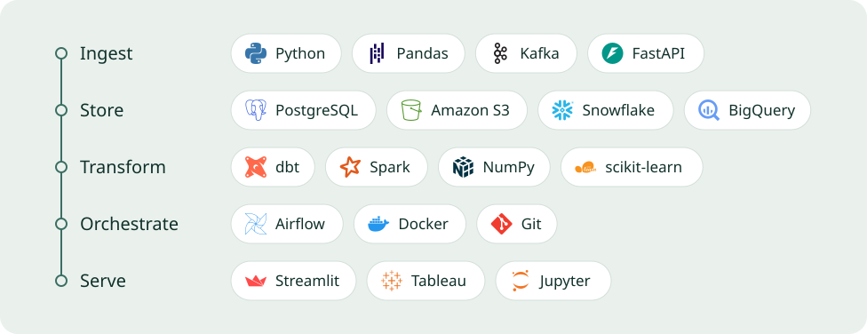

I studied Computer Science at Rutgers (GPA 3.7, Dean's List) and I work where data gets moved, cleaned and checked: SQL Server migrations, ELT into Snowflake, dbt models with tests that stop a bad run. I care most about the boring guarantees. The counts match, reruns are safe, and credentials never get into the repo.

&nbsp;

### What I've built

**[SubscriptionPulse](https://github.com/kumkumsareen1006/SubscriptionPulse)** is incremental ELT for SaaS subscription analytics.

```text
postgres (docker) ──▶ s3 / partitioned parquet ──▶ snowflake ──▶ dbt (7 models, 32 tests)
                         orchestrated as a 3-task Airflow 3 DAG, full run in ~12 s
```

It loads 201 accounts, 19,238 usage events and 1,530 invoices. `updated_at` watermarks and `COPY INTO` load tracking make every load idempotent, so a rerun picks up zero duplicates. `dim_accounts` is a Type 2 SCD snapshot. Snowflake reads S3 through a storage integration and an IAM role trust, so no keys live in the code.

**[CryptoPulse](https://github.com/kumkumsareen1006/crypto)** scores crypto market sentiment in real time with FinBERT-tone, without fine-tuning. A FastAPI backend serves the scores to an Angular and Chart.js dashboard that tracks how sentiment moves.

**E-commerce Analytics Pipeline** is ETL from APIs and flat files into PostgreSQL. Pandas cleans the data, SQL models cover sales, customers and products, and Streamlit dashboards track the KPIs.

&nbsp;

### Where I've worked

| | |
|---|---|
| **EisnerAmper**, Software Engineering Intern | Summer 2025. Consolidated 3 SQL Server databases (50+ tables) during a system migration, then reconciled the legacy data with stored procedures before go-live. |
| **West Monroe**, Strategy & Research Intern | Turned company annual reports into data-driven presentations. |
| **YMCA**, Client Services Administrator | Since 2021. Kept member records and 500+ payments accurate in Daxko. |

&nbsp;

### What I use, by pipeline stage



I also write SQL every day, and Java when it's called for.

&nbsp;

### Get in touch

I'm looking for data engineering roles. Email is the quickest way to reach me: **[kumkumsareen04@gmail.com](mailto:kumkumsareen04@gmail.com)**

[Portfolio](https://kumkumsareen.me) &nbsp;&nbsp; [LinkedIn](https://www.linkedin.com/in/kumkumsareen/) &nbsp;&nbsp; [Résumé](https://kumkumsareen.me/Resume/Resume.pdf)
