**Data engineer · Rutgers Computer Science, May 2026 · Edison, NJ**

I build pipelines that move, clean and check data, and I make sure the numbers add up at every step. I've worked on SQL Server migrations, ELT into Snowflake, Spark and Delta Lake lakehouses, and dbt models with tests that stop a bad run. My priorities are row counts that match, reruns that are safe, and credentials that stay out of the repo.

Open to data engineering roles. [Portfolio](https://kumkumsareen.me) · [LinkedIn](https://www.linkedin.com/in/kumkumsareen/) · [Résumé](https://kumkumsareen.me/Resume/Resume.pdf)

&nbsp;

### Projects

| Project | What it does | Stack |
|---|---|---|
| **[Vantage](https://github.com/kumkumsareen1006/Vantage)** | Lakehouse that finds Wikipedia articles with a sudden spike in attention, from hourly pageviews and the live edit stream. Bronze, silver and gold Delta layers with a quarantine table. It separates likely bot traffic from real news, and a `kill -9` restart test lost zero events. The next phase moves it to Azure. | `PySpark` `Delta Lake` `Kafka` `Structured Streaming` `pytest` |
| **[SubscriptionPulse](https://github.com/kumkumsareen1006/subscriptionpulse)** | Incremental ELT for SaaS subscription analytics, from Dockerized Postgres to partitioned Parquet on S3, then Snowflake and dbt. Watermarks and `COPY INTO` load tracking make reruns add zero duplicates. 7 dbt models, including a Type 2 SCD, and 32 tests that fail the run on bad data. [Docs](https://kumkumsareen1006.github.io/subscriptionpulse/) | `Python` `PostgreSQL` `S3` `Snowflake` `dbt` `Airflow 3` `Docker` |
| **[E-commerce Data Pipeline](https://github.com/kumkumsareen1006/ecommerce-data-pipeline)** | ETL from a CSV and an API into PostgreSQL. Pandas cleans and transforms the data, SQL covers category sales and top products, and a Streamlit dashboard shows the results. | `Python` `Pandas` `PostgreSQL` `Streamlit` |

&nbsp;

### Experience

| Role | |
|---|---|
| **Software Engineering Intern**, EisnerAmper Jun – Aug 2025 | Centralized and validated data from 3 SQL Server databases (50+ tables) during a system migration. Wrote SQL and stored procedures to profile, cleanse and reconcile legacy data before go-live, and documented data lineage for stakeholders. |
| **Strategy & Research Intern**, West Monroe Jul – Aug 2022 | Analyzed annual reports for 5+ companies, built Excel models to benchmark competitors, and turned the findings into presentations and briefs for the consulting team. |
| **Client Services Administrator**, YMCA Dec 2021 – present | Keeps member records and 500+ payments accurate in Daxko, cleans up duplicate accounts, and tracks new, churned and paused members each month. |

&nbsp;

### Education

**Rutgers University**, B.S. Computer Science, May 2026 · GPA 3.7, Dean's List 
Coursework: Database Management, Data Structures & Algorithms, Data Science, Statistics, Computer Architecture

&nbsp;

### Skills

| | |
|---|---|
| **Languages** | SQL, Python, C#, Java |
| **Processing & storage** | PySpark, Delta Lake, Kafka, Pandas, PostgreSQL, SQL Server, Snowflake, Amazon S3 |
| **Transformation & orchestration** | dbt, Apache Airflow, Docker, Git, GitHub Actions |
| **Data practices** | Incremental ELT, dimensional modeling, Type 2 SCD, data quality testing, idempotent loads, query optimization |
| **Serving** | Streamlit, FastAPI |

&nbsp;

### Contact

Email is the quickest way to reach me: **[kumkumsareen04@gmail.com](mailto:kumkumsareen04@gmail.com)**
